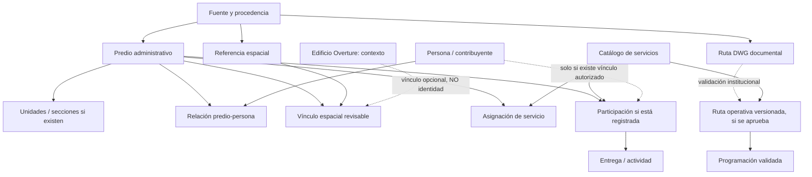

# WEBGIS BAGUA — dominio, alcance y restricciones

Consolidación documental: 17/11/2026. Define el dominio objetivo; no es esquema SQL
existente, inventario de funciones ni autorización institucional. Identidad y valor
en [PRODUCT.md](PRODUCT.md); interacción en
[entorno integrado](VISION_ENTORNO_GEOGRAFICO_INTEGRADO.md); verificación en
[criterios](CRITERIOS_ACEPTACION_CODEX.md); estado en
[avance único](docs/avance-verificado.md).

## 1. Alcance y lectura de requisitos

BAGUA MASTER relaciona predios, personas, unidades, servicios, rutas, programación,
participación y actividades. La cobertura trabajada no implica toda la provincia.
La falta de datos oficiales de Rentas no impide construir con contratos y muestras
local/test aisladas; no acredita compatibilidad automática con el futuro padrón.
El visor histórico se preserva, pero su DEMO no define ni alimenta el nuevo padrón real.

- **[FIJO]**: decisión expresa o restricción vigente.
- **[OBJETIVO]**: capacidad requerida; no acredita implementación.
- **[DISEÑO PROPUESTO]**: solución ajustable al código y validación del área usuaria.
- **[POR VALIDAR]**: decisión institucional desconocida; no inventar aprobación.
- **[REPORTADO]**: antecedente no revalidado en esta consolidación.

Fuera de alcance: arbitrios y funciones tributarias financieras (tarifas, montos,
deudas, pagos, cobranza, recaudación o morosidad); catastro jurídico que acredite
propiedad o límites; GPS de camiones en tiempo real; optimización automática de
rutas sin datos/autorización; integrar indiscriminadamente el proyecto paralelo de
puntos críticos/incidencias; IA predictiva como requisito central. La proximidad
no prueba prestación. Completar cartografía faltante no bloquea tareas independientes.

## 2. ALCANCE, ACTORES Y RESPONSABILIDAD DE LAS FUENTES

### 2.1 Cobertura territorial

**[FIJO]** El proyecto pertenece a la Municipalidad Provincial de Bagua, pero la **cobertura de datos no se declara automáticamente como toda la provincia**. La fase cartográfica trabajada se centra en Bagua ciudad y sectores/localidades presentes en fuentes y ámbito de atención (incluidos, documentalmente, Tomaque, Brujo Pata y Casuarinas). El sistema debe poder incorporar nuevas zonas sin rediseñarse.

### 2.2 Personas que usarán el sistema (roles funcionales, no permisos ya aprobados)

| Actor | Trabajo real que la aplicación debe apoyar |
|---|---|
| Personal de consulta municipal | Buscar predios, ver fichas autorizadas, localizar y consultar servicios |
| Responsable de gestión ambiental | Validar catálogos, asignaciones, actividades, criterios y reportes |
| Personal de registro / campo | Ubicar o verificar referencias, registrar entregas y actualizar lo permitido desde móvil |
| Responsable de rutas / servicio | Consultar trazados, vigencia de programas y documentar verificaciones operativas |
| Administrador del sistema | Gestionar cuentas, roles, permisos, catálogos, integridad y respaldos |
| Fuente de datos Rentas | Proveer datos autorizados y definiciones administrativas; **no** ser operador del WebGIS por defecto |
| Catastro/Desarrollo Urbano | Proveer, cuando exista, información espacial y nomenclatura autorizada |

**[POR VALIDAR]** Denominación exacta de cargos, funciones, permisos y responsabilidades de aprobación. Nunca presentar esta tabla como organigrama oficial aprobado.

### 2.3 Quién sabe qué

- **Rentas / Administración Tributaria:** predios administrativos, contribuyentes, relación entre ellos, direcciones, características declaradas, identificadores e históricos **si existen y están autorizados**. No se solicitan arbitrios o información económica.
- **Catastro / Desarrollo Urbano u oficina competente:** códigos catastrales, geometrías de lotes/manzanas, nomenclatura y referencias espaciales **si existen**.
- **Gestión Ambiental y Residuos Sólidos:** tipos y modos de servicio, atención, rutas operativas, periodos, horarios reales, participantes, entregas y criterios de gestión; requiere validación con personal responsable.
- **Fuentes CAD/DWG:** geometrías, marcas y anotaciones documentales con fecha y limitaciones; no son certificación operativa.
- **Overture Maps:** cartografía de contexto urbano versionada; no catastro oficial ni padrón tributario.

Si Rentas **también posee** registros sobre tipo de generador, participación o entregas, **se pueden recibir de manera complementaria, exclusivamente si existen y se autoriza su tratamiento**, conservando fecha, fuente, significado y grado de confirmación. **No asumir que posee esos registros.**

---

## 3. MODELO CONCEPTUAL DEL DOMINIO (NO ES ESQUEMA SQL EXISTENTE)

> **[OBJETIVO / DISEÑO PROPUESTO]** El nombre de tablas, tipos, índices y claves concretos deben decidirse tras inspeccionar el repositorio y los datos reales. No recrear tablas ya existentes ni introducir una migración destructiva.

### 3.1 Entidades que no se deben fusionar

| Entidad | Representa | No significa |
|---|---|---|
| **Predio administrativo** | Registro identificado por Rentas o fuente autorizada | Una edificación o título de propiedad |
| **Unidad/sección predial** | Departamento, local, sección u otra subdivisión registrada | Un inmueble siempre independiente por intuición |
| **Referencia espacial/catastral** | Geometría o punto respaldado por una fuente | Identidad jurídica o tributaria automática |
| **Edificio Overture** | Objeto de cartografía de contexto, con `overture_id` y versión | Predio fiscal ni altura real certificada |
| **Persona/entidad** | Registro administrativo de persona natural/jurídica, datos mínimos autorizados | Ocupante, propietario o generador por defecto |
| **Relación predio–persona** | Tipo, fuente, estado y vigencia del vínculo | Relación permanente ni necesariamente exclusiva |
| **Usuario/generador del servicio** | Unidad o actor definido según proceso operativo | Sinónimo automático de contribuyente |
| **Servicio** | Modalidad municipal de atención | Una entrega ya realizada |
| **Asignación/cobertura** | Relación prevista o autorizada de servicio a unidad o zona | Evidencia de prestación efectiva |
| **Ruta documental** | Trazado y atributos extraídos de DWG | Ruta vigente ni distancia real recorrida por camión |
| **Ruta operativa validada** | Versión confirmada por área responsable, con vigencia | La misma tabla documental renombrada sin evidencia |
| **Programación** | Días, turnos, frecuencia, horario con fuente y vigencia | Registro de ejecución |
| **Participación** | Vinculación de un participante a modalidad o programa | Entrega consumada |
| **Entrega/actividad** | Evento ocurrido y registrado, con fecha y responsable | Simple inscripción o asignación |
| **Fuente/procedencia** | Archivo, sistema, versión, responsable y fecha | Veracidad absoluta por tener hash |
| **Usuario/rol/auditoría** | Acceso y cambios realizados | Autorización municipal implícita de todo el dataset |

### 3.2 Relaciones y cardinalidades mínimas



En el modelo real, las relaciones con personas, unidades, servicios y geometrías deben admitir multiplicidad y **cambios históricos**. Un predio sin coordenadas válidas puede existir sin vínculo espacial. Una ruta documental puede existir sin ruta operativa validada.

### 3.3 Atributos transversales recomendados

Para cada entidad sensible o susceptible de cambios, valorar: `id_interno`, `codigo_origen`, `fuente_id`, `registrado_en`, `actualizado_en`, `vigente_desde`, `vigente_hasta`, `estado`, `responsable_registro`, `responsable_validacion`, `evidencia`, `observaciones`, `version` y campos de auditoría. **Son sugerencias conceptuales**, no exigencia de esos nombres literales.

Para asociaciones espaciales, registrar además `metodo_vinculacion`, `precision_o_confianza`, `estado_revision`, `revisor`, `fecha_revision`. Distinguir información de ubicación **confirmada**, **aproximada**, **pendiente** y **conflictiva**. La ubicación aproximada no puede mostrarse como exacta.

### 3.4 Identidad externa y contratos de intercambio

IDs internos estables y claves externas con sistema/fuente y vigencia. Evaluar
unicidad por fuente, clave y versión solo si la clave es fiable. Un cambio de código
exige correspondencia explícita; no emparejar automáticamente por nombre o dirección.
Los adaptadores y diccionarios deben ser versionables: significado, obligatoriedad,
sensibilidad, claves, nulos y relaciones dependen de la entrega autorizada.

Búsqueda paginada por tipo/permisos, detalle por ID opaco, geometría opcional con
estado de revisión, mutaciones auditadas y errores estructurados son contratos
orientativos; reutilizar los existentes antes de crear nuevas rutas o tablas.

### 3.5 Estados: varios ejes, nunca un único booleano mágico

No reducir todo a `is_valid=true/false`. Separar por lo menos:

- **Existencia en fuente:** dato presente en documento, padrón o registro.
- **Calidad/localización:** sin georreferencia, georreferenciado, aproximado, ambiguo, verificado.
- **Validación administrativa:** pendiente, revisado, confirmado por área competente, observado.
- **Vigencia temporal:** desconocida, vigente, histórica/caducada según evidencia.
- **Operación:** previsto/asignado, inscrito/participante, actividad registrada; «no realizado» **solo** con evidencia.

Los valores concretos de cada enumeración se ajustarán a catálogos institucionales **[POR VALIDAR]**. Evitar que una etiqueta cartográfica «georreferenciada» se interprete como «ruta operativamente vigente».

---

## 4. CAPACIDADES FUNCIONALES DEL PRODUCTO FINAL

Cada bloque describe capacidades objetivo, no disponibilidad actual. Su aceptación se verifica en CRITERIOS_ACEPTACION_CODEX.md.

### F01. Base cartográfica y consulta territorial [FIJO / OBJETIVO]

**Debe permitir:** explorar el ámbito atendido, buscar lugares/vías/sectores disponibles, activar capas, seleccionar elementos, ver procedencia y conectar mapa con fichas de predios o rutas. Distinguir vista habitual de **modo técnico**.

**Invariantes:** preservar Overture como fuente estructural de BAGUA MASTER, no superponer un segundo fondo que duplique edificios/calles, no mover geometrías para hacer coincidir DWG, no presentar alturas inventadas como observadas. Las alturas complementarias/derivadas conservan fuente y método separados; las simuladas existentes solo se muestran por elección explícita, nunca por defecto. Los nombres DWG recuperados son **atributos documentales**, no topología Overture.

### F02. Padrón administrativo de predios [OBJETIVO]

**Debe permitir:** importar/registrar predios autorizados, listar, filtrar, buscar por códigos y dirección, consultar ficha, editar según permiso, conservar procedencia, mostrar historial y detectar potenciales duplicados. Incluir manzana/lote, uso, tipo, dirección, características, estados y unidades independientes **cuando existan**.

**Reglas:** jamás construir predio real a partir de edificios Overture o capa `VIVIENDA` CAD; preservar códigos de Rentas, no exigir geometría ni dato inexistente para crear la ficha; cambios auditados; no sustituir valores oficiales por inferencias del mapa.

### F03. Personas y relaciones con predios [OBJETIVO]

**Debe permitir:** guardar identificadores autorizados, consultar vínculos muchos-a-muchos, tipo de relación, periodos y fuente. La ficha de predio muestra únicamente lo permitido por el rol.

**Reglas:** contribuyente ≠ propietario legal ≠ ocupante ≠ generador ≠ participante. No exponer nombres/DNI/contactos en PMTiles, GeoJSON públicos, capturas o API abierta. La persona puede participar en varios vínculos y un predio puede tener varias personas.

### F04. Vinculación espacial de predios [OBJETIVO]

**Debe permitir:** asociar un predio a geometría oficial, punto verificado o referencia aproximada, con método, evidencia y revisión; mostrar registros sin ubicación en un listado de pendientes. Cuando existen varios candidatos, permitir evaluación humana.

**Reglas:** no usar proximidad a edificio, lote, etiqueta o ruta como prueba suficiente; no alterar Overture; evitar selección automática destructiva; conservar discrepancias y nivel de confianza.

### F05. Catálogo de servicios y asignaciones [OBJETIVO]

**Modalidades relevantes iniciales:** recolección convencional; orgánicos; aprovechables/reciclables. Los nombres/códigos exactos se validan con la Gerencia **[POR VALIDAR]**.

**Debe permitir:** administrar catálogo y tipos de material pertinentes; asociar servicios a predios, unidades, generadores o sectores **según la unidad de atención aprobada**; registrar modalidad, condición, fuente, responsable, vigencia y estado. Consultar todos los servicios de un predio o zona y permitir pluralidad.

**Reglas:** un uso comercial registrado en Rentas no prueba modalidad de servicio; la asignación no prueba recolección; varias modalidades pueden relacionarse con un predio. No inventar quién recibe el servicio por estar al lado de una ruta.

### F06. Rutas documentales, operativas y puntos [FIJO / OBJETIVO]

**Ya reportado:** BAGUA MASTER muestra siete rutas activas **solo DWG**; selección, ficha, flechas y marcadores. No modificar esa decisión de fuente. El WebGIS municipal original mantiene historia separada, incluso PDF archivados.

**Producto final debe permitir:** explorar trazados documentales con fuente, sector y grado de revisión; diferenciar versiones operativas validables con fecha/periodo y funcionario responsable; consultar puntos o paradas **solo cuando estén documentados/validados**; consultar sentido de flechas en cuanto atributo documental.

**Reglas:** un PDF no aporta geometría, horario, flechas, marcadores ni atributos activos a BAGUA MASTER; no hacer *snap* automático de rutas al eje Overture; ruta fragmentada no se conecta mediante conjetura; longitud de trazos no equivale a recorrido secuencial del camión; «Ruta 2026» no significa código oficial comprobado.

### F07. Horarios, frecuencias y programación [OBJETIVO]

**Debe permitir:** definir programación asociada a servicio/ruta/sector solo con fuente validada; mostrar días, franja horaria, frecuencia, fecha de inicio/fin y responsable; consultar programación histórica y actual cuando exista.

**Reglas:** anotaciones de DWG o nombre de archivo no bastan para confirmar horario vigente; no presentar una celda vacía como «sin atención»; programación ≠ ejecución.

### F08. Participación en orgánicos y aprovechables [OBJETIVO]

**Debe permitir:** identificar participantes según unidad de atención aprobada, modalidad, inscripción/estado, periodo, sector y fuente; consultar historial y cambios. Una misma unidad puede participar en más de una modalidad.

**Reglas:** contribuyente de Rentas no es automáticamente el participante. No obligar a registrar datos de contacto si no existe finalidad aprobada.

### F09. Registro de entregas y actividades [OBJETIVO EXPLÍCITO]

**Debe permitir:** registrar evento con fecha/hora cuando proceda, servicio/modalidad, tipo de material, unidad de atención/participante si está identificado, cantidad y unidad **solo si fueron medidas**, responsable y observaciones. Editar/corregir según permisos y con bitácora. Filtrar por periodo, sector, modalidad, participante y material.

**Reglas:** `cantidad = NULL` no equivale a cero; no inventar pesos, fechas, GPS, fotografías ni firmas; un registro de participación no es una entrega. Los campos obligatorios definitivos los define el flujo real de Gestión Ambiental **[POR VALIDAR]**.

### F10. Operación en campo y móvil [OBJETIVO]

**Debe permitir:** búsqueda por código/dirección, consulta mínima por permisos, revisión de ubicación y formularios claros para registrar datos. Interfaz usable con teclado táctil, botones apropiados, mensajes de validación, estados de carga y confirmación de guardado.

**[POR VALIDAR]:** geolocalización precisa, fotografías, modo sin conexión, firma, captura GPS y sincronización offline. No implementarlos como obligaciones sin justificación operacional y autorización.

### F11. Búsqueda cruzada, consultas e indicadores [OBJETIVO]

**Debe permitir:** consultas por predio, código, dirección, sector, servicio, modalidad, ruta y periodo; exportaciones autorizadas, tablas y estadísticas con contexto de fuente, periodo y cobertura.

**Reglas:** indicadores de cobertura necesitan denominador conocido; distinguir 0 de desconocido; no publicar personas en reportes abiertos; no atribuir rendimiento a camiones, toneladas totales o cumplimiento de horarios si no existen mediciones válidas.

### F12. Administración, integridad y transferencia [OBJETIVO]

**Debe permitir:** autenticación, perfiles y permisos por acción/recurso, catálogos, importación segura, registros de cambios, respaldo/restauración comprobables, documentación, capacitación y mantenimiento sin depender de cuenta personal del desarrollador.

**Reglas:** la interfaz ocultando botones NO basta como control de acceso; el backend y consultas deben verificar permisos. Datos municipales y de prueba separados. No exponer secretos ni fuentes privadas en Git.

---

## 5. ARQUITECTURA TÉCNICA Y CONVIVENCIA CON LO YA CONSTRUIDO

### 5.1 Stack vigente [REPORTADO]

- Frontend: **React + TypeScript + Vite**, Tailwind CSS, shadcn/ui, React Router, TanStack Query/Table, React Hook Form, Zod.
- Motor cartográfico: **MapLibre GL JS**; teselas **PMTiles** derivadas de fuentes controladas.
- Backend: **Node.js + Express + TypeScript**, REST / OpenAPI.
- Persistencia: **PostgreSQL 17 + PostGIS** (versiones reportadas; verificar instalaciones actuales), acceso `pg`, migraciones versionadas.
- Distribución: **Docker Compose + Nginx**.
- Calidad: TypeScript, ESLint, Prettier, Vitest, Playwright y scripts del monorepo.
- Procesamiento GIS existente: Python, ODA File Converter, ezdxf, PyMuPDF, pyproj, GDAL/QGIS/PostGIS según caso.

**[FIJO]** Conservar PMTiles propias, recursos de la API local e identificadores Overture. No reemplazar fuentes de calles, edificios, agua, usos o lugares por OpenStreetMap, OpenFreeMap u otro proveedor, ni cargar un estilo remoto para sustituir la base. OpenFreeMap puede orientar únicamente la estética mediante estilos locales.

**[FIJO]** No migrar a GeoServer, microservicios, Kubernetes, Firebase, GraphQL u otro stack porque «parece más moderno» sin una necesidad comprobada y aprobación.

### 5.2 Los dos módulos cartográficos, NO confundir

| Subsistema | Función | Regla de evolución |
|---|---|---|
| **WebGIS municipal original** | Capas CAD/documentales, histórico, elementos de revisión y herramientas técnicas | Preservarlo, no borrar sus fuentes ni asumir que todo es oficial |
| **BAGUA MASTER** | Producto central: gestión territorial/operativa sobre Overture y rutas DWG documentales | Mantener aislamiento, teselas, geometrías, estilos correctos y catálogo DWG-only |

**BAGUA MASTER [REPORTADO]:** ruta de UI `/bagua-master`; código en `frontend/src/features/bagua-master/`, `backend/src/modules/bagua-master/`, API `/api/bagua-master`; esquema `bagua_master`; migraciones 009–012 del módulo según documentación. Verificar nombres, carpetas y rutas reales antes de tocar archivos.

### 5.3 Cifras históricas de referencia, NO promesas de estado actual [REPORTADO]

- Snapshot Overture fijo trabajado: **2026-09-23.1**.
- **14.357** edificios Overture: NO predios tributarios ni alturas reales.
- **1.679** segmentos viales; **938** con nombre original y **741** sin él en el snapshot documentado.
- Enriquecimiento DWG: **113** segmentos adicionales con nombre, **52** nombres distintos; **628** sin nombre tras la recuperación.
- Rutas DWG activas en BAGUA MASTER: **7** (4 documentadas como georreferenciadas y 3 en revisión).
- Flechas: **946** almacenadas y **942** representadas, diferencia puntual de 4 no explicada totalmente; **31** marcadores.
- Último corte de pruebas reportado: **76 E2E aprobadas y 5 omitidas**; no se ha vuelto a ejecutar aquí.

Estas cifras miden **universos distintos**, no sumarlas ni convertirlas en métricas de cobertura de predios. El reporte no acredita que las rutas operen realmente ni que los datos actuales mantengan los mismos conteos.

### 5.4 Catálogo de rutas legado de BAGUA MASTER [REPORTADO]

| Ruta | Clasificación documental comunicada |
|---|---|
| 1001 | Georreferenciada (no vigente por ese solo hecho) |
| 2001 | Georreferenciada |
| 2002 | Georreferenciada |
| 2026 · Tomaque, Brujo Pata y Casuarinas | Georreferenciada; «2026» no es código oficial demostrado |
| La Primavera | En revisión |
| Capa RUTAS | En revisión |
| Orgánica | En revisión |

Las rutas comercial e institucional con **geometría exclusivamente PDF** quedaron fuera del catálogo activo. No reimportarlas. No completar horarios ni estados por el nombre del archivo. No rehacer auditoría forense GIS salvo defecto verificable y acotado.

### 5.5 Separación sugerida de capas de datos [DISEÑO PROPUESTO]

```text
FUENTES EXTERNAS / MUNICIPALES
  Rentas (predios, contribuyentes y vínculos autorizados)
  Catastro / nomenclatura (si existe)
  Gestión Ambiental (servicios, actividades, validaciones)
  CAD/DWG (documental)        Overture (base estructural)
              │
              ▼
STAGING SEGURO + VALIDACIÓN + PROCEDENCIA
  formatos, esquemas, códigos, fechas, duplicados, conflictos
              │
              ▼
DOMINIOS PERSISTIDOS
  administrativo: predios, personas, relaciones
  territorial: referencias y correspondencias revisables
  operativo: servicios, asignaciones, rutas validadas, entregas
  transversal: fuentes, permisos, auditoría
              │
              ▼
API REST CON AUTORIZACIÓN (NO EXPONER DATOS PERSONALES EN TESELAS)
              │
              ▼
WEBGIS BAGUA
  mapa + fichas + formularios + historial + reportes + modo técnico
```

No imponer un nuevo servicio o carpeta si el proyecto ya resuelve esa responsabilidad: **reutilizar antes de duplicar**.

---

## 6. RENTAS PENDIENTE: CÓMO AVANZAR SIN BLOQUEAR EL PROYECTO

### 6.1 Situación actual

Hasta esta versión **no existe constancia de entrega o autorización efectiva del padrón real de Rentas**. Hay una solicitud formal preparada y enviada para orientación/trámite interno, sin confirmación de recepción administrativa ni datos. La respuesta de una persona sobre los avances del proyecto no equivale a aprobación del acceso a padrones.

### 6.2 Qué puede hacerse ya [OBJETIVO]

1. Inspeccionar repositorio y migraciones; identificar modelos existentes de predios, usuarios, rutas y servicios.
2. Definir **contratos de importación** independientes del formato real de Rentas: claves, campos opcionales, diccionario y versiones.
3. Construir **staging**, validaciones, idempotencia, bitácora y gestión de errores con datos sintéticos.
4. Implementar **padrón demo de prueba**, ficha, búsqueda, edición controlada, vínculos muchos-a-muchos, estados y localización pendiente.
5. Preparar gestión de catálogo de servicios y asignaciones con **valores expresamente marcados como demostración**, sin presentarlos como modalidad municipal validada.
6. Construir registro de entregas de orgánicos/aprovechables con ejemplos sintéticos y reglas de integridad.
7. Diseñar permisos y pruebas de privacidad antes de cargar datos personales.
8. Establecer una lista precisa de preguntas/campos a confirmar con Rentas, Catastro y Gestión Ambiental.

### 6.3 Qué NO hacer por falta de respuesta [FIJO]

- No fabricar contribuyentes reales ni suponer sus domicilios o documentos.
- No convertir edificios, viviendas CAD o puntos cercanos en predios administrativos oficiales.
- No hacer *scraping* de padrones personales ni obtener datos de servicios externos sin autorización.
- No bloquear interfaces y backend hasta disponer del padrón: admitir relaciones/atributos opcionales.
- No publicar datos sintéticos mezclados con datos reales sin una separación explícita.
- No incrustar nombres reales, DNI, contactos o exportaciones privadas en fuentes de código o pruebas.
- No diseñar acoplamiento permanente a columnas desconocidas del sistema tributario.

### 6.4 Muestras sintéticas y aislamiento [FIJO]

Solo desarrollo/test con destino explícito, sin usar NODE_ENV como única barrera;
[procedimiento](docs/segregacion-fixtures.md). Semillas deterministas y explícitas,
con identidades ficticias no colisionables y rótulo «Datos de prueba — no oficiales».
No asociar personas/predios ficticios a viviendas reales como si fueran registros
municipales; las ubicaciones de ensayo se identifican y separan de la base cartográfica.
La limpieza se limita al entorno y registros de prueba autorizados, nunca a datos
municipales. La persistencia de producto es API/BD; arrays o localStorage no sustituyen
registros operativos. El día de la entrega real se ensaya importación acotada en
entorno no productivo con respaldo, conciliación y plan de reversión que preserve
cambios no relacionados.

### 6.5 Cuando llegue información real

**Procedimiento objetivo:** verificar autorización y finalidad → inventariar tablas/formatos/fechas → asegurar transferencia privada → validar claves/relaciones/nulos/duplicados → importar a staging → generar informe de conflictos → aprobar importación → registrar fuente y versión → probar búsqueda y fichas → revisar permiso y privacidad → establecer mecanismo de actualización futura.

**No se requieren arbitrios** para la finalidad actual. Si Rentas tiene datos adicionales operativos sobre residuos y su entrega está autorizada, tratarlos como fuente complementaria con calidad y vigencia declaradas, no como verdad de ejecución por defecto.

---

## 7. SEGURIDAD, PRIVACIDAD, INTEGRIDAD Y AUDITORÍA

### 7.1 Datos personales [FIJO]

- Aplicar finalidad, minimización, confidencialidad y acceso autorizado conforme a reglas institucionales y normativa aplicable.
- Identificadores internos preferibles cuando basten; identidad directa solo cuando sea necesaria y permitida.
- Separar almacenamiento / consulta de datos sensibles de cartografía compartida o pública.
- **Nunca** incluir nombres, documentos de identidad, teléfonos, correos o vínculos personales en PMTiles/GeoJSON abiertos o respuestas sin autorización.
- Usar datos sintéticos o seudonimizados en entornos de desarrollo, capturas, ejemplos y tests; seudonimizar no equivale a eliminar toda obligación de protección.

### 7.2 Permisos por acción [DISEÑO PROPUESTO; perfiles finales por validar]

| Acción | Consulta | Registro/campo | Responsable área | Administrador técnico |
|---|---|---|---|---|
| Ver mapa y rutas documentales | Sí | Sí | Sí | Sí |
| Ver ficha de predio no sensible | Según autorización | Sí | Sí | Según necesidad |
| Ver identidad de contribuyente | No por defecto | Solo si habilitado | Solo si habilitado | No por defecto |
| Crear/editar registro de actividad | No | Sí, de su ámbito | Sí | Solo mantenimiento autorizado |
| Validar rutas/horarios operativos | No | No por defecto | Sujeto a designación | No por defecto |
| Importar padrón de Rentas | No | No | Según designación | Operación técnica con aprobación |
| Gestionar cuentas y permisos | No | No | Según procedimiento | Sí, con trazabilidad |

**La tabla es propuesta, no política aprobada.** Implementar denegación segura y verificar en API; no confundir «administrador técnico» con autorización universal para leer datos personales.

### 7.3 Reglas de integridad

- Migraciones **versionadas**; nunca alterar retroactivamente una ya aplicada: emitir otra.
- Importadores **transaccionales e idempotentes**, con controles sobre claves y duplicados.
- Respaldo antes de migraciones potencialmente destructivas y **prueba de restauración**.
- Fuentes originales y derivados mantenidos con procedencia, hash cuando proceda, fecha y condiciones de uso.
- No borrar datos municipales con limpieza de `seed:demo` ni tests.
- Las bajas y modificaciones deben respetar historial relevante y dependencias de eventos.
- Auditoría de cambios: quién, qué, cuándo, anterior/nuevo según sensibilidad y política; no exponer identificadores innecesarios en logs.
- Las integraciones deben poder detenerse ante datos incompatibles, con resumen claro de errores, sin escrituras parciales no deseadas.

---

## 8. INDICADORES Y REPORTES: QUÉ SE PODRÁ AFIRMAR

**Indicadores legítimos solo con registros y denominadores conocidos:**

- Número de predios cargados por sector, tipo o uso; fecha y fuente del padrón.
- Predios con ubicación **verificada, aproximada, pendiente o conflictiva**.
- Predios o participantes con asignación/inscripción registrada por modalidad.
- Cantidad de entregas registradas por periodo, sector, material o modalidad.
- Suma de cantidades **solo cuando se midieron** y respetando unidades; no sumar kg con unidades heterogéneas sin conversión justificada.
- Evolución de participantes/entregas registrados con definición temporal.
- Registros pendientes de corregir o validar, incidencias de calidad y cobertura documental.

**No afirmar:** cobertura universal, eficacia del recojo, puntualidad de camiones, cantidad total generada por la población, toneladas municipales totales ni porcentaje de participación sobre toda la ciudad si el sistema carece de universo y mediciones representativas.

**Ejemplo crítico:** «30 % de participación» requiere **numerador**, **denominador definido**, **fecha**, **ámbito**, **qué significa participar** y **cobertura del padrón**. Si faltan, presentar conteo parcial, no porcentaje engañoso.

---

## 9. CALIDAD NO FUNCIONAL Y CONDICIONES DE OPERACIÓN

| Dimensión | Comportamiento esperado | Cómo evaluarla |
|---|---|---|
| Usabilidad | Personal no técnico puede consultar predio y registrar actividad | Pruebas de tarea en PC y móvil con usuarios del área |
| Rendimiento | Búsqueda, mapas y formularios responden de manera razonable a tamaños reales | Medición con dataset representativo; no inventar umbrales oficiales |
| Confiabilidad | Reintentos no duplican entregas ni importaciones; fallos se informan | Tests de idempotencia y errores controlados |
| Seguridad | No existe acceso directo no autorizado a padrones | Tests por rol en UI, API y exportaciones |
| Integridad GIS | Overture y trazos DWG protegidos no se desplazan por nuevas funciones | Comparación de huellas/geometrías y pruebas de regresión |
| Calidad de datos | No se ocultan duplicados, nulos ni correspondencias dudosas | Reportes de validación y listas de revisión |
| Auditabilidad | Cambios administrativos/operativos relevantes tienen responsable y fecha | Consulta de historial y bitácora |
| Mantenibilidad | Documentación, migraciones, configuración y despliegue reproducibles | Instalación/recuperación por personal designado |
| Transferibilidad | Municipalidad puede usarlo sin credenciales personales del practicante | Entrega institucional y capacitación |

No reclamar uso offline, alta disponibilidad, geolocalización GPS ni tiempos exactos de servicio como compromisos aceptados sin prueba y definición institucional.

---

## 10. DECISIONES PENDIENTES: NO INVENTAR RESPUESTAS

| Pregunta | Fuente de decisión | Hasta entonces |
|---|---|---|
| ¿Qué es la unidad de atención: predio, vivienda, establecimiento, generador o combinación? | Gestión Ambiental | Modelo con relaciones explícitas, no supuestos uno-a-uno |
| ¿Qué significa «usuario» y qué tipo de generador se registra? | Gestión Ambiental | No inferir de contribuyente o uso del predio |
| ¿Qué campos hacen obligatoria una entrega? ¿Quién registra/corrige? | Personal operativo | Formularios configurables/prototipos con datos demo |
| ¿Qué rutas, días y horarios están vigentes? | Responsable municipal | Mostrar solo evidencia documental |
| ¿Qué fuente tiene direcciones y catastro oficiales? | Rentas/Catastro | Mantener nombres/ubicaciones de origen |
| ¿Qué datos y tablas entregará Rentas? ¿Con qué autorización? | Dependencia competente | Contrato flexible + ejemplos sintéticos |
| ¿Quién puede ver nombres/DNI y editar registros? | Gerencia/área competente | Denegar acceso sensible por defecto |
| ¿Cómo se desplegará y quién lo mantendrá? | Municipalidad | Mantener instalación local reproducible y documentación |
| ¿Qué zonas quedan comprendidas en cada servicio? | Gestión Ambiental | No calcular «cobertura atendida» por proximidad |

El agente debe marcar cada punto no respondido como **decisión pendiente con impacto y dueño**, no generar una «confirmación» por conveniencia.

---

## 11. FUENTES DE ESTE DOCUMENTO Y PRECEDENCIA

Este archivo sintetiza **información proporcionada por el responsable del proyecto**, no resultados nuevos de auditoría ni hechos comprobados mediante una inspección actual del repositorio.

1. **`CONTEXTO_INTEGRAL_PROYECTO_WEBGIS_BAGUA(1).md`** (aportado el 11/11/2026): fuente conceptual principal sobre problema, objetivos, procesos, entidades, reglas, alcance y producto esperado.
2. **`TRANSFERENCIA_COMPLETA_WEBGIS_BAGUA_2026-11-03(1).docx`** (03/11/2026): fuente técnica/histórica de stack, BAGUA MASTER, Overture, DWG, rutas, conteos, migraciones, limitaciones y estado reportado a octubre.
3. **Solicitud de información para Rentas y decisiones expresas del 12/11/2026:** requerimiento de predios/contribuyentes/relaciones; **exclusión posterior explícita de arbitrios y datos financieros**; información sobre residuos solo como complemento si existe y está autorizada; trámite institucional aún sin respuesta confirmada al consolidar esta versión.

**Regla de precedencia:** objetivo formal y decisiones posteriores explícitas del responsable del proyecto prevalecen sobre propuestas anteriores. En particular, aunque documentos iniciales contemplaban solicitar **clasificaciones de arbitrios no financieros**, la **decisión más reciente es excluir los arbitrios de la solicitud y del alcance actual**. Si una decisión cambia, documentarla expresamente; no reinterpretarla en silencio.

**Límite de evidencia:** «implementado» en reportes anteriores significa **informado por agentes**, no verificado aquí mediante repositorio, BD real ni aceptación institucional. Este archivo no reemplaza código, contratos OpenAPI, migraciones, diccionarios de datos, manuales ni aprobación de la Gerencia.

---
